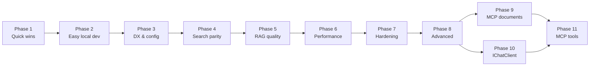

# Generellem Improvement Plan

## How we'll work

- **One step at a time** — finish, verify, then move on.
- **Each step has a clear "done when"** so we know when to stop.
- **Unit tests when practical** for each step.
- **Phases 1–8 are complete.** Phase 9 (MCP documents) and Phase 10 (`IChatClient`) are independent and both ready. Phase 11 starts after both.



---

## Phase 1 — Quick wins (foundation)

**Goal:** Fix real bugs, protect `main`, and clean up obvious inconsistencies.

| Step | Task | Done when |
|------|------|-----------|
| **1.1** | Fix chat history in `GenerellemHostedService` | ✅ Done — `ChatHistoryRecorder` records turns; both demos updated; RAG labels assistant messages correctly |
| **1.2** | Add CI workflow (`build` + `test` on PR and push to `main`) | ✅ Done — `.github/workflows/ci.yml` runs Release build + 102 tests on PRs and pushes to `main` |
| **1.3** | Repo hygiene | ✅ Done — `.DS_Store` gitignored and removed from index; README typos and URLs standardized to `JoeMayo/generellem` |
| **1.4** | Resolve `.doc` inconsistency | ✅ Done — `.doc` enabled in factory and `Word.SupportedExtensions`; factory tests updated |

**Estimated effort:** ~1–2 sessions  
**Dependencies:** None

---

## Phase 2 — Easy local development (NEW)

**Goal:** A developer can `git clone` → `dotnet run` and try Generellem in minutes, with **no Azure account, no Qdrant, and no user secrets** required for the default path.

### The problem today

| Component | Current requirement | Already simple? |
|-----------|-------------------|-----------------|
| Document hash DB | SQLite (`generellem.db` in AppData) | ✅ Yes |
| Vector search | Qdrant (endpoint, API key, collection) | ❌ No |
| Embeddings | Azure OpenAI deployment | ❌ No |
| LLM / chat | Azure OpenAI deployment | ❌ No |
| Demo config | User secrets + manual 15-line DI setup | ❌ No |

Every new developer must provision cloud services before seeing a single answer. That is the main adoption blocker.

### Proposed solution: hosting profiles

Introduce **profiles** that swap `ISearchService`, `IEmbedding`, and `ILlm` implementations via one call:

```csharp
// Zero-infrastructure — works immediately after clone
services.AddGenerellem(GenerellemProfile.InMemory);

// Local AI — one Ollama install, no cloud keys
services.AddGenerellem(GenerellemProfile.Ollama);

// Current production path — unchanged
services.AddGenerellem(GenerellemProfile.Azure);
```

### Profile tiers (simplest → most capable)

#### Tier A — `InMemory` (target: default for demos & CI)

**Best for:** First run, CI, contributors validating the pipeline, teaching how RAG works.

| Piece | Implementation |
|-------|----------------|
| Vector store | `InMemorySearchService` — chunks + embeddings in a `ConcurrentDictionary` |
| Embeddings | `DeterministicEmbeddingService` — hash-based or fixed-dimension fake vectors (pattern exists in `TestEmbeddings`) |
| LLM | `LocalLlmService` — template responses using retrieved context, or a simple extractive answer |

- **Setup:** `dotnet run` — nothing else
- **Trade-off:** Retrieval quality is not semantically meaningful; answers demonstrate the *flow*, not production AI quality
- **Must be clearly labeled** in the console banner: *"InMemory profile — for local demo only"*

#### Tier B — `Sqlite` vectors (target: file-based, no Docker)

**Best for:** Developers who want persistence without running a vector DB server.

SQLite is **already used** for document hashes. Extend it to store chunk text + embedding vectors in a new table.

| Approach | Complexity | Notes |
|----------|------------|-------|
| **B1 — Brute-force cosine search in C#** | Low | Fine for hundreds of chunks; query all vectors, rank in memory. Good enough for dev. |
| **B2 — sqlite-vec extension** | Medium | Native vector index in the same `.db` file; better scale; needs per-platform native binaries. |

Recommendation: start with **B1** (pure .NET, no native deps), add B2 later if needed.

Combine with Tier A embeddings initially, or with Ollama embeddings (Tier C) for real semantic search.

#### Tier C — `Ollama` (target: real local AI, still no cloud)

**Best for:** Developers with a GPU or reasonable CPU who want real answers locally.

| Piece | Implementation |
|-------|----------------|
| LLM | `OllamaLlm` — OpenAI-compatible chat API at `http://localhost:11434` |
| Embeddings | `OllamaEmbedding` — e.g. `nomic-embed-text` (768-dim; must make dimensions configurable) |
| Vector store | `InMemory` or `Sqlite` (Qdrant not required) |

- **Setup:** Install [Ollama](https://ollama.com), run `ollama pull llama3.2` + `ollama pull nomic-embed-text`, then `dotnet run -- --profile Ollama`
- **Trade-off:** Model download size, RAM/GPU requirements; embedding dimensions differ from hardcoded 1536

#### Tier D — `Docker` (optional convenience path)

**Best for:** Developers who want Qdrant-like behavior without manual Qdrant install.

```yaml
# docker-compose.yml
services:
  qdrant:
    image: qdrant/qdrant
    ports: ["6333:6333", "6334:6334"]
  ollama:          # optional
    image: ollama/ollama
```

Still more steps than Tier A/B, but one command: `docker compose up -d`.

#### Tier E — `Azure` (existing, production)

Keep current `AzureOpenAILlm`, `AzureOpenAIEmbedding`, `QdrantService` / `AzureSearchService` as the production profile. No behavior change for existing users.

### Phase 2 steps

| Step | Task | Done when |
|------|------|-----------|
| **2.1** | Define `GenerellemProfile` enum and `AddGenerellem(profile)` extension | ✅ Done — `GenerellemProfile` + `AddGenerellem` in `DependencyInjection/` |
| **2.2** | Implement `InMemorySearchService` | ✅ Done — singleton in-memory cosine search + unit tests |
| **2.3** | Implement `DeterministicEmbeddingService` | ✅ Done — hash-based embeddings + unit tests |
| **2.4** | Implement `LocalLlmService` (InMemory profile) | ✅ Done — extractive answers from retrieved context + unit tests |
| **2.5** | Make embedding dimensions configurable | ✅ Done — `GenerellemOptions.EmbeddingDimensions` used by Qdrant/Azure Search |
| **2.6** | Implement `SqliteSearchService` (brute-force dev search) | ✅ Done — `VectorChunks` table + EF migration + unit tests |
| **2.7** | Add `appsettings.Local.json` + `--profile` CLI flag | ✅ Done — console defaults to InMemory; all profiles documented in banner |
| **2.8** | Quick Start section in README | ✅ Done — 3-step clone-and-run guide |
| **2.9** | Implement `OllamaLlm` + `OllamaEmbedding` | ✅ Done — Ollama HTTP API; InMemory or Sqlite search via options |
| **2.10** | Optional `docker-compose.yml` | ✅ Done — Qdrant + Ollama services |

**Estimated effort:** ~4–6 sessions (2.1–2.8 deliver the core "clone and run" experience; 2.9–2.10 are stretch)

**Dependencies:** Phase 1 complete

### Recommended default experience after Phase 2

```bash
git clone https://github.com/JoeMayo/generellem
cd generellem/GenerellemConsole
dotnet run
# → InMemory profile, ingests bundled docs, interactive Q&A — no secrets, no Docker, no Azure
```

For real AI locally:

```bash
ollama pull llama3.2 && ollama pull nomic-embed-text
dotnet run -- --profile Ollama
```

For production (unchanged):

```bash
dotnet user-secrets set ...   # Azure + Qdrant keys
dotnet run -- --profile Azure
```

### What stays as-is

- `GenerellemContext` / SQLite for document hashes — no change needed
- `ISearchService`, `IEmbedding`, `ILlm` interfaces — new implementations plug in behind existing contracts
- Azure + Qdrant path — remains the production recommendation

---

## Phase 3 — Developer experience & configuration

**Goal:** Polish configuration for all profiles (not just local).

| Step | Task | Done when |
|------|------|-----------|
| **3.1** | Expand `GenerellemOptions` | ✅ Done — chunk size, overlap, top-K, temperature, subfolder, and profile settings bind from the `Generellem` section; Ollama env keys still override |
| **3.2** | Replace static mutable config | ✅ Done — `SubFolder`, chunk settings, and embedding retry progress are instance/options scoped |
| **3.3** | Startup configuration validation | ✅ Done — `GenerellemStartupValidator` runs first. InMemory and Sqlite require no keys. Ollama checks its endpoint and models. Azure requires Azure OpenAI plus Qdrant, or Azure AI Search when `UseAzureSearch` is set. Invalid chunk settings fail for every profile |
| **3.4** | Rename custom `IHttpClientFactory` | ✅ Done — `IGenerellemHttpClientFactory` / `GenerellemHttpClientFactory`; references updated |

**Estimated effort:** ~2 sessions  
**Dependencies:** Phase 2 (profiles and options introduced together)

---

## Phase 4 — Search service parity

**Goal:** Cloud backends can be swapped without runtime surprises.

| Step | Task | Done when |
|------|------|-----------|
| **4.1** | Audit `ISearchService` contract | ✅ Done — keep one interface. InMemory, Sqlite, Qdrant, and Azure AI Search implement every method |
| **4.2** | Implement missing Azure Search methods | ✅ Done — path lookup, delete-by-tenant, and source lookup use the same filters as Qdrant |
| **4.3** | Align Azure Search index schema with Qdrant | ✅ Done — `SourceReference`, `Path`, `TenantID`, and `GroupID` are filterable. Existing indexes gain the fields on startup. New uploads store them |
| **4.4** | Implement `SearchBySourceReferenceAsync` in Qdrant | ✅ Done — same lookup as `GetDocumentReferencesAsync`. Qdrant also indexes those payload fields |
| **4.5** | Add tests for parity gaps | ✅ Done — schema, filters, and the new methods are covered. `Generellem:UseAzureSearch` switches the Azure profile's backend |

**Estimated effort:** ~2 sessions  
**Dependencies:** Phase 2–3

---

## Phase 5 — RAG quality

**Goal:** Better answers, more control, more trust.

| Step | Task | Done when |
|------|------|-----------|
| **5.1** | Make retrieval parameters configurable | ✅ Done — chunk size and overlap come from options in `TextProcessor`. Embedding dimensions size deterministic embeddings, Qdrant, and Azure AI Search. Top-K now also limits Qdrant and Azure AI Search |
| **5.2** | Sentence/paragraph-aware chunking | ✅ Done — `TextProcessor` packs paragraph and sentence boundaries, then words, and cuts characters only when a unit is longer than the chunk |
| **5.3** | Source citations in responses | ✅ Done — the system prompt tells the model to cite `DocumentReference`, and `AskAsync` appends a Sources list |
| **5.4** | Make intent summarization optional | ✅ Done — `Generellem:SummarizeUserIntent` defaults to true. Set it to false to search with the raw query and skip the extra LLM call |
| **5.5** | Prompt injection hardening | ✅ Done — retrieved text is sanitized and wrapped in untrusted-context delimiters. The system prompt treats that block as data |

**Estimated effort:** ~3 sessions  
**Dependencies:** Phase 2–3

---

## Phase 6 — Performance

**Goal:** Faster ingestion and leaner service calls.

| Step | Task | Done when |
|------|------|-----------|
| **6.1** | Register `QdrantClient` via DI (singleton/scoped) | ✅ Done — Azure profile registers one `QdrantClient` and one `QdrantService`. Methods reuse that client |
| **6.2** | Batched/parallel embedding during ingestion | ✅ Done — `EmbeddingBatchSize` (default 16) batches Azure and Ollama embedding calls. HTTP 429 waits use `Retry-After` or exponential backoff |
| **6.3** | Decouple ingest from query in console demo | ✅ Done — `--mode both\|ingest\|query` and `Generellem:RunMode` on both demos. Default remains both |
| **6.4** | Cache `collectionExists` invalidation | ✅ Done — only a positive answer is cached, it expires, `NotFound` clears it, and index creation asks Qdrant instead of trusting the cache |

**Estimated effort:** ~2 sessions  
**Dependencies:** Phase 2–4

---

## Phase 7 — Hardening & confidence

**Goal:** Catch regressions and validate real integrations.

| Step | Task | Done when |
|------|------|-----------|
| **7.1** | Integration tests with Testcontainers (Qdrant) | ✅ Done — `QdrantIngestSearchQueryTests` ingests, searches, and queries one document in `qdrant/qdrant:v1.15.5`. The client factory passes an explicit URL port and still uses 6334 when the URL omits one. The test skips only when Docker is absent |
| **7.2** | InMemory profile smoke test in CI | ✅ Done — CI runs `GenerellemConsole` `--profile InMemory --mode both` against a temp file and then `quit`. No secrets and no wiki crawl |
| **7.3** | CI coverage reporting | ✅ Done — `coverlet` collects Cobertura on the test step, the job summary prints line and branch rates, and the report is uploaded. No threshold |
| **7.4** | Update GitHub Actions to v4 | ✅ Done — docfx workflow `checkout` and `setup-dotnet` are v4. DocFX build and Pages deploy are unchanged. `ci.yml` was already v4 |
| **7.5** | Remove or implement `Promptlet` stub | ✅ Done — removed the empty `Generellem.Templates.Promptlet` type. Nothing else referenced it |

**Estimated effort:** ~2–3 sessions  
**Dependencies:** Phases 1–2

---

## Phase 8 — Advanced

**Goal:** Competitive RAG features on the hardened core path.

| Step | Task | Done when |
|------|------|-----------|
| **8.1** | Hybrid search (vector + keyword) | ✅ Done — `SearchAsync(queryText, embedding)` on every backend. Azure uses BM25 plus a vector query. Qdrant adds a `lexical` sparse vector and fuses with RRF, falling back to dense search when sparse is unavailable. SQLite uses FTS5. InMemory fuses keyword overlap with cosine. Blank query text stays vector-only |
| **8.2** | Reranking step | ✅ Done — `RerankMode` defaults to `Lexical` and keeps the original order on ties. `Llm` is opt-in. `None` skips rerank. Rerank runs before context assembly |
| **8.3** | Multimodal ingestion | ✅ Done — `.jpg`, `.jpeg`, `.png`, `.gif`, and `.bmp` are ingested. PNG text chunks and JPEG comments are read, and the file name is always included. `EnableImageVision` plus `VisionModel` adds an Ollama or Azure vision pass |
| **8.4** | Streaming responses | ✅ Done — `ILlm.StreamAsync` and `AskStreamAsync` yield tokens, then the citation suffix. Both demos print tokens. `AskAsync` stays non-streaming. The local profile stream concatenates to the same answer |
| **8.5** | sqlite-vec native index | ✅ Done — sqlite-vec 0.1.9 loadable binaries ship for osx-arm64, osx-x64, linux-x64, and win-x64. Search uses the vec0 cosine index when the extension loads, and brute-force cosine otherwise |
| **8.6** | .NET 10 target + package versioning | ✅ Done — library, tests, and demos target `net10.0`. Microsoft.Extensions and EF Core are 10.0.14. Package version is 1.1.0. A `vMAJOR.MINOR.PATCH` tag packs the nupkg and publishes a GitHub release |

---

## Phase 9 — MCP document sources

**Goal:** Ingest documents from MCP servers through the existing `IDocumentSource` pipeline. Notion, Google Docs, Loop, and a logged-in website are MCP servers the user runs. Generellem does not grow a connector per product.

**Status:** Next. Not started.

MCP resources are the same shape as `GetDocumentsAsync`: a list of items, then the bytes or text of each one. `Ingestion` already extracts text, hashes it, chunks it, embeds it, and deletes references that the source no longer returns. Phase 9 adds a source. It leaves chunking, embeddings, `ISearchService`, `ILlm`, and the query loop alone.

### What stays

- `FileSystem` and `Website` from `EnterpriseDocumentSourceFactory`. An empty MCP list is today's console. `dotnet run` still needs no extra process.
- `MSGraphDocumentSourceFactory` and the OneDrive demo. Phase 9 does not add MCP there.
- `IDocumentType` and `DocumentTypeFactory`. A blob is still a PDF, a Word file, or HTML. Text the server already extracted is not parsed again as a binary format.
- `ILlm`, `IEmbedding`, and the four search backends. MCP has no chat-completion or embedding method. Sampling asks the host to call a model, which is the other direction. Replacing `ILlm` with `IChatClient` is Phase 10 and is not part of this phase.
- Azure OpenAI, Ollama, and the extractive local answer, until Phase 10. Gemini, Anthropic, and Mistral do not become Generellem connector classes.

### Configuration

Add `McpServers` under the `Generellem` section. The default is an empty list. `GenerellemStartupValidator` checks the list on every profile. An empty list adds no errors and no servers.

Each entry:

| Field | Rule |
|-------|------|
| `Name` | Required. `^[A-Za-z0-9][A-Za-z0-9_-]{0,63}$`. Unique. One name must not be a prefix of another. Deletion looks up `DocumentReference` with `StartsWith(Reference)`, so `notes` would also match `notes-extra`. |
| `Transport` | `stdio` or `http`. |
| `Command`, `Arguments`, `Environment` | `stdio` only. `Command` is required. `Url` is forbidden. |
| `Url`, `Headers` | `http` only. `Url` is an absolute `http` or `https` URI. `Command` is forbidden. |
| `MaxResources` | Optional. Default 10000. |

`McpMaxBlobBytes` defaults to 20 MiB of decoded bytes. Headers and environment values are credentials. Do not log them, and do not put real secrets in `appsettings.json`. The README sample uses placeholders and points at environment variables or user secrets.

`Reference` for a server is `mcp:{Name}`. `DocumentInfo` already builds `DocumentReference` as `{Reference}@{path}`, so a resource URI `wiki/home` on server `notes` is stored as `mcp:notes@wiki/home`. That prefix is what `RemoveDeletedDocumentsAsync` passes to `GetDocumentReferencesAsync`.

### Mapping a resource to `DocumentInfo`

`resources/list` is paged until the cursor is exhausted. `resources/templates/list` is not expanded. A template has no arguments in this phase.

`resources/read` becomes one document:

- A blob whose MIME type or URI extension maps to a type `DocumentTypeFactory` can process is the document. The stream is the decoded bytes. Known MIME types cover the extensions the factory already handles (`application/pdf` to `.pdf`, the Office MIME types, `text/html`, `text/markdown`, `text/plain`, and the image types). An unknown MIME type falls through to the URI extension. `Unknown` is skipped by ingestion, and the URI is still recorded as seen.
- When no processable blob is present, text blocks are concatenated with newlines. `text/html` uses `Html`. `text/markdown` uses `Markdown`. Any other `text/*`, or a missing MIME type, uses `Text`.
- A blob larger than `McpMaxBlobBytes` is skipped and logged. The URI is still seen.
- A resource with no processable contents is skipped. The URI is still seen.

"Seen" matters. `RemoveDeletedDocumentsAsync` deletes indexed documents whose references were not returned. A read that fails, a blob that is too large, or a type we cannot parse must still count as seen, so a transient failure does not delete the stored copy. A URI that is absent from a successful list is a real deletion.

Connection, initialization, or listing failure throws out of `GetDocumentsAsync` before any document is yielded. `Ingestion` already catches that, logs it, and `continue`s, which skips deletion for that source. A successful list that is empty is a real empty source and does delete previously indexed documents for that prefix. Hitting `MaxResources` throws the same way as a connection failure. Truncating the list and then deleting the tail would be wrong.

Dispose the client when the enumeration finishes or is cancelled. The stdio transport owns the child process, so dispose must end that process. Do not cache the client across ingest runs in this phase.

### Steps

| Step | Task | Done when |
|------|------|-----------|
| **9.1** | Options and startup validation | `GenerellemOptions` binds `McpServers` and `McpMaxBlobBytes` from the `Generellem` section. The validator rejects a bad name, a prefix collision, a missing command or URL, and a transport that sets both. An empty list passes on every profile. Tests cover one valid stdio entry, one valid HTTP entry, and each rejection. `appsettings.json` leaves the list empty |
| **9.2** | Resource mapper | A pure mapper turns one listed resource plus its read result into a `DocumentInfo` or a seen-but-skipped URI. Tests cover text, HTML, a PDF blob chosen by MIME type, an extensionless URI that becomes `Unknown`, an oversized blob, and a read that returns no contents. `DocumentReference` is `mcp:{name}@{uri}` |
| **9.3** | `McpDocumentSource` | Implements `IDocumentSource`. It connects with `McpClient.CreateAsync`, pages `ListResources`, reads each resource, and yields mapped documents. `Reference` is `mcp:{name}`. One failed read is logged and the URI stays seen. A failed connect throws before the first yield. Cancellation disposes the client. Logging includes the server name and URI and excludes headers, environment values, and document text |
| **9.4** | Console factory | `EnterpriseDocumentSourceFactory` still returns `FileSystem` then `Website`, then one `McpDocumentSource` per configured server. `DemoDocumentSourceFactoryTests` still expects those two types when the list is empty, and expects a third source when one server is configured. `MSGraphDocumentSourceFactory` is unchanged. The library references `ModelContextProtocol.Core` only |
| **9.5** | In-process round trip | A test hosts an MCP server in-process over the SDK's stream transport (`Pipe` plus `StreamServerTransport` / `StreamClientTransport`). No `npx`, Docker, or network. The source yields a text resource and a small blob, skips a failing read without dropping its URI, and a second list that omits a URI leaves that URI out of the seen set. The test project may reference `ModelContextProtocol` for the in-process server |
| **9.6** | README | A short Configure section shows one stdio entry and one HTTP entry with placeholder secrets. It states that built-in sources still run, that the server decides which resources exist, and that Generellem stores only what a successful read returns |

**Estimated effort:** one step per session.

**Dependencies:** Phases 1–8. No dependency on Phase 10 or Phase 11.

### Left for later

- Resource subscriptions and `resources/updated`. A full list plus the existing content hash is the change signal.
- Resource templates, prompts, sampling, and tools. Tools are Phase 11.
- Generellem exposing itself as an MCP server.
- OAuth inside Generellem. The user passes headers or environment values through to a server that already knows how to sign in.
- Replacing `FileSystem`, `Website`, or OneDrive with an MCP server.

---

## Phase 10 — Any chat model via `IChatClient`

**Goal:** Use Gemini, Anthropic, Mistral, and the next service without a Generellem connector for each one. The RAG pipeline calls `IChatClient` from `Microsoft.Extensions.AI`. A new model is an OpenAI-compatible endpoint plus a model name, or an `IChatClient` the host registers.

**Status:** In progress. 10.1 is done. Independent of Phase 9.

`ILlm` is a small interface, and the pipeline does not use it that way. `GenerellemDefaultRag.BuildRequestAsync` always builds an `AzureOpenAIChatRequest` of `OpenAI.Chat.ChatMessage`. `OllamaLlm` and `LocalLlmService` accept only that request. `LlmReranker` casts the response to `AzureOpenAIChatResponse`. Both demos store history in `Queue<OpenAI.Chat.ChatMessage>`. A Gemini or Anthropic class would have to pretend to be Azure. Phase 10 removes that shape from the pipeline.

### Boundary

- The library references `Microsoft.Extensions.AI.Abstractions`. It uses `IChatClient`, `ChatMessage`, `ChatOptions`, and `IEmbeddingGenerator<string, Embedding<float>>`.
- The built-in client is the OpenAI SDK pointed at `OpenAIClientOptions.Endpoint` (`AsIChatClient()`). `Azure.AI.OpenAI` is already on the dependency graph. Raise that package if `AsIChatClient()` is missing from 2.1.0.
- The library does not reference Anthropic, Google, or Mistral packages. A test reads the `Generellem` assembly references and fails if those names appear.
- Temperature is passed through on `ChatOptions`. Generellem does not clamp it. OpenAI accepts 0–2 and Mistral accepts 0–1, and the provider enforces its own range.
- Chat history in `IRag`, `IGenerellemQuery`, and both demos is `IList<ChatMessage>` from `Microsoft.Extensions.AI`.

### Two ways to select a model

1. **OpenAI-compatible settings.** `ChatEndpoint`, `ChatApiKey`, and `ChatModel` under the `Generellem` section. This covers Mistral, Groq, OpenRouter, Together, vLLM, LM Studio, Ollama at `http://localhost:11434/v1`, and Gemini's OpenAI-compatible endpoint. A blank API key is allowed when the endpoint is loopback. When the endpoint is set, the model name is required.
2. **Host registration.** The host replaces the `IChatClient` registration. Anthropic and Google SDKs that expose `AsIChatClient()` are referenced by `GenerellemConsole` or the caller's app, not by the library. Azure AD authentication stays this kind of override. An API key for Azure OpenAI uses the built-in client.

The Ollama profile becomes the built-in client at `{OllamaEndpoint}/v1` with `OllamaChatModel`. The hand-rolled `OllamaLlm` HTTP path goes away once the stub-handler tests match today's request and stream behavior.

InMemory and Sqlite register an `ExtractiveChatClient` that Generellem owns. It returns the same extractive answer `LocalLlmService` returns today. It never calls a network and never requests a tool.

### Embeddings

Embeddings are a second registration. Anthropic has no embeddings API, so the chat provider and the embedding provider may differ.

- `EmbeddingEndpoint`, `EmbeddingApiKey`, and `EmbeddingModel` select an OpenAI-compatible embeddings endpoint. `EmbeddingDimensions` still has to match the index.
- The Ollama profile uses `{OllamaEndpoint}/v1` and `OllamaEmbeddingModel` when those fields are blank.
- The Azure profile keeps its Azure OpenAI embedding deployment.
- InMemory and Sqlite keep `DeterministicEmbeddingService`.
- `IEmbedding` stays the ingestion API (`EmbedAsync` chunks a document). The vector call inside it goes through `IEmbeddingGenerator<string, Embedding<float>>`.

### Steps

| Step | Task | Done when |
|------|------|-----------|
| **10.1** | Package and options | ✅ Done — `Microsoft.Extensions.AI.Abstractions` 10.11.0. `ChatEndpoint`, `ChatApiKey`, `ChatModel`, `EmbeddingEndpoint`, `EmbeddingApiKey`, and `EmbeddingModel` bind from the `Generellem` section and stay empty in `appsettings.json`. A set endpoint must be an absolute http(s) URI and must name a model. A blank API key is allowed only for a loopback endpoint. Package version is 2.0.0 |
| **10.2** | Extractive client | `ExtractiveChatClient` implements `IChatClient` and reproduces `LocalLlmService` answers, including the stream that concatenates to the same text. InMemory and Sqlite register it. Existing ask and stream tests pass |
| **10.3** | OpenAI-compatible client | A stub `HttpMessageHandler` proves one non-streaming call and one streaming call against `/v1/chat/completions`, with the configured model and bearer key. The Ollama profile registers this client at `{OllamaEndpoint}/v1`. No live Ollama in CI |
| **10.4** | Pipeline uses `IChatClient` | `GenerellemDefaultRag`, `AzureOpenAIQuery`, `LlmReranker`, and both demos take `IList<ChatMessage>` and call `IChatClient`. They do not mention `AzureOpenAIChatRequest`, `AzureOpenAIChatResponse`, or `OpenAI.Chat`. Intent summary is one `GetResponseAsync` call. Temperature is `ChatOptions.Temperature` |
| **10.5** | Embeddings | An OpenAI-compatible `IEmbeddingGenerator<string, Embedding<float>>` serves the Ollama profile and a configured embedding endpoint, proved with a stub handler against `/v1/embeddings`. Azure embeddings and `DeterministicEmbeddingService` stay. A mismatch between the returned vector length and `EmbeddingDimensions` fails the call |
| **10.6** | Azure registration | The Azure profile registers `IChatClient` through the Azure OpenAI SDK's `AsIChatClient()` using the existing API key and deployment. RAG code has no Azure chat types. A host can replace `IChatClient` after `AddGenerellem` for Entra or another vendor |
| **10.7** | Remove the old chat types | `ILlm`, `AzureOpenAILlm`, `OllamaLlm`, `LocalLlmService`, `AzureOpenAIChatRequest`, and `AzureOpenAIChatResponse` are deleted when nothing references them. The assembly-reference test fails if `Generellem` references Anthropic, Google.GenAI, or Mistral |
| **10.8** | README | Shows a Mistral-shaped OpenAI-compatible example with a placeholder key, shows the Ollama profile as that same client, and shows a host replacing `IChatClient` for a vendor SDK. States that embeddings are configured separately and that Generellem ships no per-vendor connector |

**Estimated effort:** 10.4 is the large step. The others are one session each.

**Dependencies:** Phases 1–8. No dependency on Phase 9.

### Left for later

- A Generellem class per vendor. That is the outcome this phase exists to avoid.
- Clamping temperature or rewriting tool schemas per provider. `IChatClient` and the provider SDK own that.
- MCP tool calls. Those are Phase 11, on `ChatOptions` of this client.

---

## Phase 11 — MCP tools at query time

**Goal:** On any `IChatClient` that can request tools, a question can call tools on the MCP servers from Phase 9. Retrieval stays. The tool result is additional untrusted context. The extractive client never requests a tool.

**Status:** Recorded. Starts after Phase 9 and Phase 10.

Phase 10 supplies `ChatMessage` and tool calls, so this phase does not invent a transcript. The `McpServers` list is the set of servers. A server with no tools is ingest-only and the loop ignores it.

### Steps

| Step | Task | Done when |
|------|------|-----------|
| **11.1** | Tool loop | After the current retrieval path, the query client passes the servers' tools on `ChatOptions` and answers tool calls until the model returns text or 4 rounds have run. Tool output is wrapped as untrusted context, the same way retrieved chunks are. A tool failure is a tool result the model can see, and it does not throw out of `AskAsync` |
| **11.2** | MCP tools | The loop uses `tools/list` and `tools/call` on the configured servers through the Phase 9 client transport. `ExtractiveChatClient` is not given tools, and the InMemory profile never opens an MCP client during a question |
| **11.3** | Streaming | `AskStreamAsync` yields tokens, finishes a tool call without yielding the raw tool payload as if it were the answer, then yields the following tokens. `AskAsync` stays one string |
| **11.4** | Tests | An in-process MCP server exposes one tool. A scripted `IChatClient` requests that tool once and then answers. The final text includes the tool output |
| **11.5** | README | Documents that tools run only when the registered `IChatClient` requests them, that the round limit is 4, and that a server with no tools is still ingested |

**Estimated effort:** one step per session. The transcript work that used to sit here is Phase 10.

**Dependencies:** Phase 9 for server options and the client transport. Phase 10 for `IChatClient`.

### Left for later

- MCP prompts filling the system message.
- Sampling, elicitation, and Generellem as an MCP server.

---

## Tracking

| Phase | Status | Notes |
|-------|--------|-------|
| 1 — Quick wins | Complete | |
| 2 — Easy local dev | Complete | Profiles: InMemory, Sqlite, Ollama, Azure |
| 3 — DX & config | Complete | Options, startup validation, renamed HTTP client factory |
| 4 — Search parity | Complete | Qdrant and Azure AI Search implement the full `ISearchService` contract |
| 5 — RAG quality | Complete | Boundary chunking, citations, optional intent summary, untrusted context |
| 6 — Performance | Complete | Shared Qdrant client, batched embeddings, demo run modes, collection cache invalidation |
| 7 — Hardening | Complete | Qdrant Testcontainers, InMemory CI smoke, coverage summary, Actions v4, Promptlet removed |
| 8 — Advanced | Complete | Hybrid search, lexical rerank, image ingestion, streaming, sqlite-vec, .NET 10, semver tags |
| 9 — MCP documents | Ready | `McpDocumentSource` beside File System and Website. No new product connectors. Independent of Phase 10 |
| 10 — `IChatClient` | In progress | 10.1 done. OpenAI-compatible endpoint settings and startup checks. Package version 2.0.0. No per-vendor connector |
| 11 — MCP tools | Later | After Phase 9 and Phase 10. Tool loop on `IChatClient` |

---

## Recommended starting order

1. ~~Phase 1~~ — Complete
2. ~~Phase 2~~ — Complete (clone-and-run + Ollama/Docker)
3. ~~Phase 3~~ — Complete (options, startup validation, HTTP client rename)
4. ~~Phase 4~~ — Complete (Qdrant and Azure AI Search implement the same contract)
5. ~~Phase 5~~ — Complete (boundary chunking, citations, optional intent summary, untrusted context)
6. ~~Phase 6~~ — Complete (shared Qdrant client, batched embeddings, demo run modes, collection cache invalidation)
7. ~~Phase 7~~ — Complete (Qdrant Testcontainers, InMemory CI smoke, coverage, Actions v4, Promptlet removed)
8. ~~Phase 8~~ — Complete (hybrid search, rerank, image ingestion, streaming, sqlite-vec, .NET 10)
9. **Phase 9** — MCP document sources (ready, independent)
10. **Phase 10** — `IChatClient` for any chat model (10.1 done, independent of Phase 9)
11. Phase 11 — MCP tools at query time, after Phase 9 and Phase 10