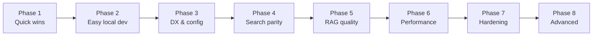

# Generellem Improvement Plan

## How we'll work

- **One step at a time** — finish, verify, then move on.
- **Each step has a clear "done when"** so we know when to stop.
- **Unit tests when practical** for each step.
- **Phases 1–8 are complete.** Start the next change from a new plan.



---

## Phase 1 — Quick wins (foundation)

**Goal:** Fix real bugs, protect `main`, and clean up obvious inconsistencies.

| Step | Task | Done when |
|------|------|-----------|
| **1.1** | Fix chat history in `GenerellemHostedService` | ✅ Done — `ChatHistoryRecorder` records turns; both demos updated; RAG labels assistant messages correctly |
| **1.2** | Add CI workflow (`build` + `test` on PR and push to `main`) | ✅ Done — `.github/workflows/ci.yml` runs Release build + 102 tests on PRs and pushes to `main` |
| **1.3** | Repo hygiene | ✅ Done — `.DS_Store` gitignored and removed from index; README typos and URLs standardized to `JoeMayo/generellem` |
| **1.4** | Resolve `.doc` inconsistency | ✅ Done — `.doc` enabled in factory and `Word.SupportedExtensions`; factory tests updated |

**Estimated effort:** ~1–2 sessions  
**Dependencies:** None

---

## Phase 2 — Easy local development (NEW)

**Goal:** A developer can `git clone` → `dotnet run` and try Generellem in minutes, with **no Azure account, no Qdrant, and no user secrets** required for the default path.

### The problem today

| Component | Current requirement | Already simple? |
|-----------|-------------------|-----------------|
| Document hash DB | SQLite (`generellem.db` in AppData) | ✅ Yes |
| Vector search | Qdrant (endpoint, API key, collection) | ❌ No |
| Embeddings | Azure OpenAI deployment | ❌ No |
| LLM / chat | Azure OpenAI deployment | ❌ No |
| Demo config | User secrets + manual 15-line DI setup | ❌ No |

Every new developer must provision cloud services before seeing a single answer. That is the main adoption blocker.

### Proposed solution: hosting profiles

Introduce **profiles** that swap `ISearchService`, `IEmbedding`, and `ILlm` implementations via one call:

```csharp
// Zero-infrastructure — works immediately after clone
services.AddGenerellem(GenerellemProfile.InMemory);

// Local AI — one Ollama install, no cloud keys
services.AddGenerellem(GenerellemProfile.Ollama);

// Current production path — unchanged
services.AddGenerellem(GenerellemProfile.Azure);
```

### Profile tiers (simplest → most capable)

#### Tier A — `InMemory` (target: default for demos & CI)

**Best for:** First run, CI, contributors validating the pipeline, teaching how RAG works.

| Piece | Implementation |
|-------|----------------|
| Vector store | `InMemorySearchService` — chunks + embeddings in a `ConcurrentDictionary` |
| Embeddings | `DeterministicEmbeddingService` — hash-based or fixed-dimension fake vectors (pattern exists in `TestEmbeddings`) |
| LLM | `LocalLlmService` — template responses using retrieved context, or a simple extractive answer |

- **Setup:** `dotnet run` — nothing else
- **Trade-off:** Retrieval quality is not semantically meaningful; answers demonstrate the *flow*, not production AI quality
- **Must be clearly labeled** in the console banner: *"InMemory profile — for local demo only"*

#### Tier B — `Sqlite` vectors (target: file-based, no Docker)

**Best for:** Developers who want persistence without running a vector DB server.

SQLite is **already used** for document hashes. Extend it to store chunk text + embedding vectors in a new table.

| Approach | Complexity | Notes |
|----------|------------|-------|
| **B1 — Brute-force cosine search in C#** | Low | Fine for hundreds of chunks; query all vectors, rank in memory. Good enough for dev. |
| **B2 — sqlite-vec extension** | Medium | Native vector index in the same `.db` file; better scale; needs per-platform native binaries. |

Recommendation: start with **B1** (pure .NET, no native deps), add B2 later if needed.

Combine with Tier A embeddings initially, or with Ollama embeddings (Tier C) for real semantic search.

#### Tier C — `Ollama` (target: real local AI, still no cloud)

**Best for:** Developers with a GPU or reasonable CPU who want real answers locally.

| Piece | Implementation |
|-------|----------------|
| LLM | `OllamaLlm` — OpenAI-compatible chat API at `http://localhost:11434` |
| Embeddings | `OllamaEmbedding` — e.g. `nomic-embed-text` (768-dim; must make dimensions configurable) |
| Vector store | `InMemory` or `Sqlite` (Qdrant not required) |

- **Setup:** Install [Ollama](https://ollama.com), run `ollama pull llama3.2` + `ollama pull nomic-embed-text`, then `dotnet run -- --profile Ollama`
- **Trade-off:** Model download size, RAM/GPU requirements; embedding dimensions differ from hardcoded 1536

#### Tier D — `Docker` (optional convenience path)

**Best for:** Developers who want Qdrant-like behavior without manual Qdrant install.

```yaml
# docker-compose.yml
services:
  qdrant:
    image: qdrant/qdrant
    ports: ["6333:6333", "6334:6334"]
  ollama:          # optional
    image: ollama/ollama
```

Still more steps than Tier A/B, but one command: `docker compose up -d`.

#### Tier E — `Azure` (existing, production)

Keep current `AzureOpenAILlm`, `AzureOpenAIEmbedding`, `QdrantService` / `AzureSearchService` as the production profile. No behavior change for existing users.

### Phase 2 steps

| Step | Task | Done when |
|------|------|-----------|
| **2.1** | Define `GenerellemProfile` enum and `AddGenerellem(profile)` extension | ✅ Done — `GenerellemProfile` + `AddGenerellem` in `DependencyInjection/` |
| **2.2** | Implement `InMemorySearchService` | ✅ Done — singleton in-memory cosine search + unit tests |
| **2.3** | Implement `DeterministicEmbeddingService` | ✅ Done — hash-based embeddings + unit tests |
| **2.4** | Implement `LocalLlmService` (InMemory profile) | ✅ Done — extractive answers from retrieved context + unit tests |
| **2.5** | Make embedding dimensions configurable | ✅ Done — `GenerellemOptions.EmbeddingDimensions` used by Qdrant/Azure Search |
| **2.6** | Implement `SqliteSearchService` (brute-force dev search) | ✅ Done — `VectorChunks` table + EF migration + unit tests |
| **2.7** | Add `appsettings.Local.json` + `--profile` CLI flag | ✅ Done — console defaults to InMemory; all profiles documented in banner |
| **2.8** | Quick Start section in README | ✅ Done — 3-step clone-and-run guide |
| **2.9** | Implement `OllamaLlm` + `OllamaEmbedding` | ✅ Done — Ollama HTTP API; InMemory or Sqlite search via options |
| **2.10** | Optional `docker-compose.yml` | ✅ Done — Qdrant + Ollama services |

**Estimated effort:** ~4–6 sessions (2.1–2.8 deliver the core "clone and run" experience; 2.9–2.10 are stretch)

**Dependencies:** Phase 1 complete

### Recommended default experience after Phase 2

```bash
git clone https://github.com/JoeMayo/generellem
cd generellem/GenerellemConsole
dotnet run
# → InMemory profile, ingests bundled docs, interactive Q&A — no secrets, no Docker, no Azure
```

For real AI locally:

```bash
ollama pull llama3.2 && ollama pull nomic-embed-text
dotnet run -- --profile Ollama
```

For production (unchanged):

```bash
dotnet user-secrets set ...   # Azure + Qdrant keys
dotnet run -- --profile Azure
```

### What stays as-is

- `GenerellemContext` / SQLite for document hashes — no change needed
- `ISearchService`, `IEmbedding`, `ILlm` interfaces — new implementations plug in behind existing contracts
- Azure + Qdrant path — remains the production recommendation

---

## Phase 3 — Developer experience & configuration

**Goal:** Polish configuration for all profiles (not just local).

| Step | Task | Done when |
|------|------|-----------|
| **3.1** | Expand `GenerellemOptions` | ✅ Done — chunk size, overlap, top-K, temperature, subfolder, and profile settings bind from the `Generellem` section; Ollama env keys still override |
| **3.2** | Replace static mutable config | ✅ Done — `SubFolder`, chunk settings, and embedding retry progress are instance/options scoped |
| **3.3** | Startup configuration validation | ✅ Done — `GenerellemStartupValidator` runs first. InMemory and Sqlite require no keys. Ollama checks its endpoint and models. Azure requires Azure OpenAI plus Qdrant, or Azure AI Search when `UseAzureSearch` is set. Invalid chunk settings fail for every profile |
| **3.4** | Rename custom `IHttpClientFactory` | ✅ Done — `IGenerellemHttpClientFactory` / `GenerellemHttpClientFactory`; references updated |

**Estimated effort:** ~2 sessions  
**Dependencies:** Phase 2 (profiles and options introduced together)

---

## Phase 4 — Search service parity

**Goal:** Cloud backends can be swapped without runtime surprises.

| Step | Task | Done when |
|------|------|-----------|
| **4.1** | Audit `ISearchService` contract | ✅ Done — keep one interface. InMemory, Sqlite, Qdrant, and Azure AI Search implement every method |
| **4.2** | Implement missing Azure Search methods | ✅ Done — path lookup, delete-by-tenant, and source lookup use the same filters as Qdrant |
| **4.3** | Align Azure Search index schema with Qdrant | ✅ Done — `SourceReference`, `Path`, `TenantID`, and `GroupID` are filterable. Existing indexes gain the fields on startup. New uploads store them |
| **4.4** | Implement `SearchBySourceReferenceAsync` in Qdrant | ✅ Done — same lookup as `GetDocumentReferencesAsync`. Qdrant also indexes those payload fields |
| **4.5** | Add tests for parity gaps | ✅ Done — schema, filters, and the new methods are covered. `Generellem:UseAzureSearch` switches the Azure profile's backend |

**Estimated effort:** ~2 sessions  
**Dependencies:** Phase 2–3

---

## Phase 5 — RAG quality

**Goal:** Better answers, more control, more trust.

| Step | Task | Done when |
|------|------|-----------|
| **5.1** | Make retrieval parameters configurable | ✅ Done — chunk size and overlap come from options in `TextProcessor`. Embedding dimensions size deterministic embeddings, Qdrant, and Azure AI Search. Top-K now also limits Qdrant and Azure AI Search |
| **5.2** | Sentence/paragraph-aware chunking | ✅ Done — `TextProcessor` packs paragraph and sentence boundaries, then words, and cuts characters only when a unit is longer than the chunk |
| **5.3** | Source citations in responses | ✅ Done — the system prompt tells the model to cite `DocumentReference`, and `AskAsync` appends a Sources list |
| **5.4** | Make intent summarization optional | ✅ Done — `Generellem:SummarizeUserIntent` defaults to true. Set it to false to search with the raw query and skip the extra LLM call |
| **5.5** | Prompt injection hardening | ✅ Done — retrieved text is sanitized and wrapped in untrusted-context delimiters. The system prompt treats that block as data |

**Estimated effort:** ~3 sessions  
**Dependencies:** Phase 2–3

---

## Phase 6 — Performance

**Goal:** Faster ingestion and leaner service calls.

| Step | Task | Done when |
|------|------|-----------|
| **6.1** | Register `QdrantClient` via DI (singleton/scoped) | ✅ Done — Azure profile registers one `QdrantClient` and one `QdrantService`. Methods reuse that client |
| **6.2** | Batched/parallel embedding during ingestion | ✅ Done — `EmbeddingBatchSize` (default 16) batches Azure and Ollama embedding calls. HTTP 429 waits use `Retry-After` or exponential backoff |
| **6.3** | Decouple ingest from query in console demo | ✅ Done — `--mode both\|ingest\|query` and `Generellem:RunMode` on both demos. Default remains both |
| **6.4** | Cache `collectionExists` invalidation | ✅ Done — only a positive answer is cached, it expires, `NotFound` clears it, and index creation asks Qdrant instead of trusting the cache |

**Estimated effort:** ~2 sessions  
**Dependencies:** Phase 2–4

---

## Phase 7 — Hardening & confidence

**Goal:** Catch regressions and validate real integrations.

| Step | Task | Done when |
|------|------|-----------|
| **7.1** | Integration tests with Testcontainers (Qdrant) | ✅ Done — `QdrantIngestSearchQueryTests` ingests, searches, and queries one document in `qdrant/qdrant:v1.15.5`. The client factory passes an explicit URL port and still uses 6334 when the URL omits one. The test skips only when Docker is absent |
| **7.2** | InMemory profile smoke test in CI | ✅ Done — CI runs `GenerellemConsole` `--profile InMemory --mode both` against a temp file and then `quit`. No secrets and no wiki crawl |
| **7.3** | CI coverage reporting | ✅ Done — `coverlet` collects Cobertura on the test step, the job summary prints line and branch rates, and the report is uploaded. No threshold |
| **7.4** | Update GitHub Actions to v4 | ✅ Done — docfx workflow `checkout` and `setup-dotnet` are v4. DocFX build and Pages deploy are unchanged. `ci.yml` was already v4 |
| **7.5** | Remove or implement `Promptlet` stub | ✅ Done — removed the empty `Generellem.Templates.Promptlet` type. Nothing else referenced it |

**Estimated effort:** ~2–3 sessions  
**Dependencies:** Phases 1–2

---

## Phase 8 — Advanced

**Goal:** Competitive RAG features on the hardened core path.

| Step | Task | Done when |
|------|------|-----------|
| **8.1** | Hybrid search (vector + keyword) | ✅ Done — `SearchAsync(queryText, embedding)` on every backend. Azure uses BM25 plus a vector query. Qdrant adds a `lexical` sparse vector and fuses with RRF, falling back to dense search when sparse is unavailable. SQLite uses FTS5. InMemory fuses keyword overlap with cosine. Blank query text stays vector-only |
| **8.2** | Reranking step | ✅ Done — `RerankMode` defaults to `Lexical` and keeps the original order on ties. `Llm` is opt-in. `None` skips rerank. Rerank runs before context assembly |
| **8.3** | Multimodal ingestion | ✅ Done — `.jpg`, `.jpeg`, `.png`, `.gif`, and `.bmp` are ingested. PNG text chunks and JPEG comments are read, and the file name is always included. `EnableImageVision` plus `VisionModel` adds an Ollama or Azure vision pass |
| **8.4** | Streaming responses | ✅ Done — `ILlm.StreamAsync` and `AskStreamAsync` yield tokens, then the citation suffix. Both demos print tokens. `AskAsync` stays non-streaming. The local profile stream concatenates to the same answer |
| **8.5** | sqlite-vec native index | ✅ Done — sqlite-vec 0.1.9 loadable binaries ship for osx-arm64, osx-x64, linux-x64, and win-x64. Search uses the vec0 cosine index when the extension loads, and brute-force cosine otherwise |
| **8.6** | .NET 10 target + package versioning | ✅ Done — library, tests, and demos target `net10.0`. Microsoft.Extensions and EF Core are 10.0.14. Package version is 1.1.0. A `vMAJOR.MINOR.PATCH` tag packs the nupkg and publishes a GitHub release |

---

## Tracking

| Phase | Status | Notes |
|-------|--------|-------|
| 1 — Quick wins | Complete | |
| 2 — Easy local dev | Complete | Profiles: InMemory, Sqlite, Ollama, Azure |
| 3 — DX & config | Complete | Options, startup validation, renamed HTTP client factory |
| 4 — Search parity | Complete | Qdrant and Azure AI Search implement the full `ISearchService` contract |
| 5 — RAG quality | Complete | Boundary chunking, citations, optional intent summary, untrusted context |
| 6 — Performance | Complete | Shared Qdrant client, batched embeddings, demo run modes, collection cache invalidation |
| 7 — Hardening | Complete | Qdrant Testcontainers, InMemory CI smoke, coverage summary, Actions v4, Promptlet removed |
| 8 — Advanced | Complete | Hybrid search, lexical rerank, image ingestion, streaming, sqlite-vec, .NET 10, semver tags |

---

## Recommended starting order

1. ~~Phase 1~~ — Complete
2. ~~Phase 2~~ — Complete (clone-and-run + Ollama/Docker)
3. ~~Phase 3~~ — Complete (options, startup validation, HTTP client rename)
4. ~~Phase 4~~ — Complete (Qdrant and Azure AI Search implement the same contract)
5. ~~Phase 5~~ — Complete (boundary chunking, citations, optional intent summary, untrusted context)
6. ~~Phase 6~~ — Complete (shared Qdrant client, batched embeddings, demo run modes, collection cache invalidation)
7. ~~Phase 7~~ — Complete (Qdrant Testcontainers, InMemory CI smoke, coverage, Actions v4, Promptlet removed)
8. ~~Phase 8~~ — Complete (hybrid search, rerank, image ingestion, streaming, sqlite-vec, .NET 10)