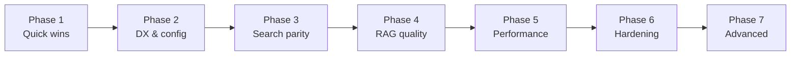

# Generellem Improvement Plan

## How we'll work

- **One step at a time** — finish, verify, then move on.
- **Each step has a clear "done when"** so we know when to stop.
- **Unit tests when practical** for each step.
- **Phases 1–3** are the highest ROI; Phases 4–6 are quality and scale; Phase 7 is optional/future.

---

## Phase 1 — Quick wins (foundation)

**Goal:** Fix real bugs, protect `main`, and clean up obvious inconsistencies.

| Step | Task | Done when |
|------|------|-----------|
| **1.1** | Fix chat history in `GenerellemHostedService` | ✅ Done — `ChatHistoryRecorder` records turns; both demos updated; RAG labels assistant messages correctly |
| **1.2** | Add CI workflow (`build` + `test` on PR and push to `main`) | GitHub Actions runs `dotnet build` and `dotnet test`; fails on broken builds |
| **1.3** | Repo hygiene | `.DS_Store` removed and gitignored; README typos and org URL inconsistencies fixed |
| **1.4** | Resolve `.doc` inconsistency | `DocumentTypeFactory` and `Word.SupportedExtensions` agree; ingestion of `.doc` works or is explicitly unsupported with docs updated |

**Estimated effort:** ~1–2 sessions  
**Dependencies:** None

---

## Phase 2 — Developer experience & configuration

**Goal:** Make Generellem easy to adopt and configure correctly.

| Step | Task | Done when |
|------|------|-----------|
| **2.1** | Introduce `GenerellemOptions` | Single options class for chunk size, overlap, top-K, embedding dimensions, temperature, search backend |
| **2.2** | Add `services.AddGenerellem(options)` extension | Both demos register services via one call; options select Qdrant vs Azure Search |
| **2.3** | Replace static mutable config | `GenerellemFiles.SubFolder`, `TextProcessor` settings, and embedding progress use instance/options scope |
| **2.4** | Startup configuration validation | Missing required keys (`GKeys`) produce clear errors at startup, not on first API call |
| **2.5** | Rename custom `IHttpClientFactory` | Renamed to avoid collision with `System.Net.Http.IHttpClientFactory`; all references updated |

**Estimated effort:** ~2–3 sessions  
**Dependencies:** Phase 1 complete (especially CI, so refactors are safe)

---

## Phase 3 — Search service parity

**Goal:** Either backend can be swapped without runtime surprises.

| Step | Task | Done when |
|------|------|-----------|
| **3.1** | Audit `ISearchService` contract | Document which methods each backend must support; decide: implement all vs split into focused interfaces |
| **3.2** | Implement missing Azure Search methods | `GetDocumentReferencesByPathAsync`, `DeleteAllAsync`, `SearchBySourceReferenceAsync` work or throw `NotSupportedException` with clear messaging |
| **3.3** | Align Azure Search index schema with Qdrant | `SourceReference`, tenant/group fields indexed consistently |
| **3.4** | Implement `SearchBySourceReferenceAsync` in Qdrant | No `NotImplementedException` on either primary backend |
| **3.5** | Add tests for parity gaps | Unit tests cover newly implemented methods; switching backend in demo is one config change |

**Estimated effort:** ~2 sessions  
**Dependencies:** Phase 2 (options should drive backend selection)

---

## Phase 4 — RAG quality

**Goal:** Better answers, more control, more trust.

| Step | Task | Done when |
|------|------|-----------|
| **4.1** | Make retrieval parameters configurable | Embedding dimensions, top-K, chunk size/overlap read from `GenerellemOptions` |
| **4.2** | Sentence/paragraph-aware chunking | `TextProcessor` splits on boundaries, not arbitrary character cuts; existing tests updated |
| **4.3** | Source citations in responses | System prompt instructs model to cite `DocumentReference`; answer includes source paths/refs |
| **4.4** | Make intent summarization optional | Config flag to skip the extra LLM call; default preserves current behavior |
| **4.5** | Prompt injection hardening | Retrieved context wrapped in clear delimiters; system prompt treats context as untrusted |

**Estimated effort:** ~3 sessions  
**Dependencies:** Phase 2 (options), Phase 3 (stable search)

---

## Phase 5 — Performance

**Goal:** Faster ingestion and leaner service calls.

| Step | Task | Done when |
|------|------|-----------|
| **5.1** | Register `QdrantClient` via DI (singleton/scoped) | Client not recreated on every `QdrantService` method call |
| **5.2** | Batched/parallel embedding during ingestion | Chunks embedded in batches with rate-limit-aware retries; measurable speedup on multi-chunk docs |
| **5.3** | Decouple ingest from query in console demo | Demo supports ingest-only, query-only, or both via flag/config |
| **5.4** | Cache `collectionExists` invalidation | Stale cache cannot cause incorrect "index missing" behavior after external changes |

**Estimated effort:** ~2 sessions  
**Dependencies:** Phase 2–3

---

## Phase 6 — Hardening & confidence

**Goal:** Catch regressions and validate real integrations.

| Step | Task | Done when |
|------|------|-----------|
| **6.1** | Integration tests with Testcontainers (Qdrant) | At least one ingest → search → query path tested against a real container |
| **6.2** | CI coverage reporting | `coverlet` runs in CI; coverage trend visible (threshold optional) |
| **6.3** | Update GitHub Actions to v4 | `checkout@v4`, `setup-dotnet@v4`; docfx workflow unchanged functionally |
| **6.4** | Remove or implement `Promptlet` stub | Empty public API surface cleaned up |

**Estimated effort:** ~2–3 sessions  
**Dependencies:** Phases 1–3

---

## Phase 7 — Advanced (future)

**Goal:** Competitive RAG features; tackle when core path is solid.

| Step | Task | Notes |
|------|------|-------|
| **7.1** | Hybrid search (vector + keyword) | Azure Search native; Qdrant sparse vectors |
| **7.2** | Reranking step | Cross-encoder or LLM rerank before context assembly |
| **7.3** | Multimodal ingestion | Image OCR / vision for supported doc types |
| **7.4** | Streaming responses | `IAsyncEnumerable` from LLM through query API |
| **7.5** | .NET 9 target + package versioning | Align TFM with EF Core 9; semver release process |

---

## Tracking

| Phase | Status | Notes |
|-------|--------|-------|
| 1 — Quick wins | In progress | 1.1 complete; next: 1.2 CI |
| 2 — DX & config | Not started | |
| 3 — Search parity | Not started | |
| 4 — RAG quality | Not started | |
| 5 — Performance | Not started | |
| 6 — Hardening | Not started | |
| 7 — Advanced | Backlog | |

---

## Recommended starting order

1. **Phase 1, Step 1.1** — Chat history fix (functional bug, small, verifiable)
2. **Phase 1, Step 1.2** — CI (safety net for all later work)
3. Continue through Phase 1, then Phase 2, etc.