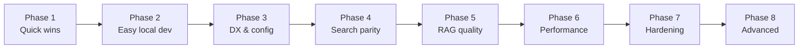

# Generellem Improvement Plan

## How we'll work

- **One step at a time** — finish, verify, then move on.
- **Each step has a clear "done when"** so we know when to stop.
- **Unit tests when practical** for each step.
- **Phase 2 is the new priority** after Phase 1 — get clone-and-run working before cloud hardening.



---

## Phase 1 — Quick wins (foundation)

**Goal:** Fix real bugs, protect `main`, and clean up obvious inconsistencies.

| Step | Task | Done when |
|------|------|-----------|
| **1.1** | Fix chat history in `GenerellemHostedService` | ✅ Done — `ChatHistoryRecorder` records turns; both demos updated; RAG labels assistant messages correctly |
| **1.2** | Add CI workflow (`build` + `test` on PR and push to `main`) | ✅ Done — `.github/workflows/ci.yml` runs Release build + 102 tests on PRs and pushes to `main` |
| **1.3** | Repo hygiene | ✅ Done — `.DS_Store` gitignored and removed from index; README typos and URLs standardized to `JoeMayo/generellem` |
| **1.4** | Resolve `.doc` inconsistency | ✅ Done — `.doc` enabled in factory and `Word.SupportedExtensions`; factory tests updated |

**Estimated effort:** ~1–2 sessions  
**Dependencies:** None

---

## Phase 2 — Easy local development (NEW)

**Goal:** A developer can `git clone` → `dotnet run` and try Generellem in minutes, with **no Azure account, no Qdrant, and no user secrets** required for the default path.

### The problem today

| Component | Current requirement | Already simple? |
|-----------|-------------------|-----------------|
| Document hash DB | SQLite (`generellem.db` in AppData) | ✅ Yes |
| Vector search | Qdrant (endpoint, API key, collection) | ❌ No |
| Embeddings | Azure OpenAI deployment | ❌ No |
| LLM / chat | Azure OpenAI deployment | ❌ No |
| Demo config | User secrets + manual 15-line DI setup | ❌ No |

Every new developer must provision cloud services before seeing a single answer. That is the main adoption blocker.

### Proposed solution: hosting profiles

Introduce **profiles** that swap `ISearchService`, `IEmbedding`, and `ILlm` implementations via one call:

```csharp
// Zero-infrastructure — works immediately after clone
services.AddGenerellem(GenerellemProfile.InMemory);

// Local AI — one Ollama install, no cloud keys
services.AddGenerellem(GenerellemProfile.Ollama);

// Current production path — unchanged
services.AddGenerellem(GenerellemProfile.Azure);
```

### Profile tiers (simplest → most capable)

#### Tier A — `InMemory` (target: default for demos & CI)

**Best for:** First run, CI, contributors validating the pipeline, teaching how RAG works.

| Piece | Implementation |
|-------|----------------|
| Vector store | `InMemorySearchService` — chunks + embeddings in a `ConcurrentDictionary` |
| Embeddings | `DeterministicEmbeddingService` — hash-based or fixed-dimension fake vectors (pattern exists in `TestEmbeddings`) |
| LLM | `LocalLlmService` — template responses using retrieved context, or a simple extractive answer |

- **Setup:** `dotnet run` — nothing else
- **Trade-off:** Retrieval quality is not semantically meaningful; answers demonstrate the *flow*, not production AI quality
- **Must be clearly labeled** in the console banner: *"InMemory profile — for local demo only"*

#### Tier B — `Sqlite` vectors (target: file-based, no Docker)

**Best for:** Developers who want persistence without running a vector DB server.

SQLite is **already used** for document hashes. Extend it to store chunk text + embedding vectors in a new table.

| Approach | Complexity | Notes |
|----------|------------|-------|
| **B1 — Brute-force cosine search in C#** | Low | Fine for hundreds of chunks; query all vectors, rank in memory. Good enough for dev. |
| **B2 — sqlite-vec extension** | Medium | Native vector index in the same `.db` file; better scale; needs per-platform native binaries. |

Recommendation: start with **B1** (pure .NET, no native deps), add B2 later if needed.

Combine with Tier A embeddings initially, or with Ollama embeddings (Tier C) for real semantic search.

#### Tier C — `Ollama` (target: real local AI, still no cloud)

**Best for:** Developers with a GPU or reasonable CPU who want real answers locally.

| Piece | Implementation |
|-------|----------------|
| LLM | `OllamaLlm` — OpenAI-compatible chat API at `http://localhost:11434` |
| Embeddings | `OllamaEmbedding` — e.g. `nomic-embed-text` (768-dim; must make dimensions configurable) |
| Vector store | `InMemory` or `Sqlite` (Qdrant not required) |

- **Setup:** Install [Ollama](https://ollama.com), run `ollama pull llama3.2` + `ollama pull nomic-embed-text`, then `dotnet run -- --profile Ollama`
- **Trade-off:** Model download size, RAM/GPU requirements; embedding dimensions differ from hardcoded 1536

#### Tier D — `Docker` (optional convenience path)

**Best for:** Developers who want Qdrant-like behavior without manual Qdrant install.

```yaml
# docker-compose.yml
services:
  qdrant:
    image: qdrant/qdrant
    ports: ["6333:6333", "6334:6334"]
  ollama:          # optional
    image: ollama/ollama
```

Still more steps than Tier A/B, but one command: `docker compose up -d`.

#### Tier E — `Azure` (existing, production)

Keep current `AzureOpenAILlm`, `AzureOpenAIEmbedding`, `QdrantService` / `AzureSearchService` as the production profile. No behavior change for existing users.

### Phase 2 steps

| Step | Task | Done when |
|------|------|-----------|
| **2.1** | Define `GenerellemProfile` enum and `AddGenerellem(profile)` extension | One DI call replaces 15-line manual registration in demos |
| **2.2** | Implement `InMemorySearchService` | Implements `ISearchService`; stores/searches chunks in memory; unit tests pass |
| **2.3** | Implement `DeterministicEmbeddingService` | Implements `IEmbedding`; produces consistent vectors without API calls; unit tests pass |
| **2.4** | Implement `LocalLlmService` (InMemory profile) | Implements `ILlm`; answers using retrieved context without external API; demo runs end-to-end |
| **2.5** | Make embedding dimensions configurable | `GenerellemOptions.EmbeddingDimensions` replaces hardcoded `1536` in search services |
| **2.6** | Implement `SqliteSearchService` (brute-force dev search) | Vectors persisted in SQLite alongside hashes; survives restart; unit tests pass |
| **2.7** | Add `appsettings.Local.json` + `--profile` CLI flag | `GenerellemConsole` defaults to `InMemory` in Debug; documents all profiles |
| **2.8** | Quick Start section in README | New developer follows 3-step guide and gets answers in < 5 minutes |
| **2.9** | Implement `OllamaLlm` + `OllamaEmbedding` | Real local AI with configurable model names; works with InMemory or Sqlite search |
| **2.10** | Optional `docker-compose.yml` | Qdrant + Ollama available for developers who want server-based local stack |

**Estimated effort:** ~4–6 sessions (2.1–2.8 deliver the core "clone and run" experience; 2.9–2.10 are stretch)

**Dependencies:** Phase 1 complete

### Recommended default experience after Phase 2

```bash
git clone https://github.com/JoeMayo/generellem
cd generellem/GenerellemConsole
dotnet run
# → InMemory profile, ingests bundled docs, interactive Q&A — no secrets, no Docker, no Azure
```

For real AI locally:

```bash
ollama pull llama3.2 && ollama pull nomic-embed-text
dotnet run -- --profile Ollama
```

For production (unchanged):

```bash
dotnet user-secrets set ...   # Azure + Qdrant keys
dotnet run -- --profile Azure
```

### What stays as-is

- `GenerellemContext` / SQLite for document hashes — no change needed
- `ISearchService`, `IEmbedding`, `ILlm` interfaces — new implementations plug in behind existing contracts
- Azure + Qdrant path — remains the production recommendation

---

## Phase 3 — Developer experience & configuration

**Goal:** Polish configuration for all profiles (not just local).

| Step | Task | Done when |
|------|------|-----------|
| **3.1** | Expand `GenerellemOptions` | Chunk size, overlap, top-K, temperature, profile-specific settings in one options class |
| **3.2** | Replace static mutable config | `GenerellemFiles.SubFolder`, `TextProcessor` settings, and embedding progress use instance/options scope |
| **3.3** | Startup configuration validation | Missing required keys produce clear errors at startup per profile (InMemory validates nothing; Azure validates all `GKeys`) |
| **3.4** | Rename custom `IHttpClientFactory` | Renamed to avoid collision with `System.Net.Http.IHttpClientFactory`; all references updated |

**Estimated effort:** ~2 sessions  
**Dependencies:** Phase 2 (profiles and options introduced together)

---

## Phase 4 — Search service parity

**Goal:** Cloud backends can be swapped without runtime surprises.

| Step | Task | Done when |
|------|------|-----------|
| **4.1** | Audit `ISearchService` contract | Document which methods each backend must support; decide: implement all vs split into focused interfaces |
| **4.2** | Implement missing Azure Search methods | `GetDocumentReferencesByPathAsync`, `DeleteAllAsync`, `SearchBySourceReferenceAsync` work or throw `NotSupportedException` with clear messaging |
| **4.3** | Align Azure Search index schema with Qdrant | `SourceReference`, tenant/group fields indexed consistently |
| **4.4** | Implement `SearchBySourceReferenceAsync` in Qdrant | No `NotImplementedException` on either primary backend |
| **4.5** | Add tests for parity gaps | Unit tests cover newly implemented methods; switching backend in demo is one config change |

**Estimated effort:** ~2 sessions  
**Dependencies:** Phase 2–3

---

## Phase 5 — RAG quality

**Goal:** Better answers, more control, more trust.

| Step | Task | Done when |
|------|------|-----------|
| **5.1** | Make retrieval parameters configurable | Embedding dimensions, top-K, chunk size/overlap read from `GenerellemOptions` |
| **5.2** | Sentence/paragraph-aware chunking | `TextProcessor` splits on boundaries, not arbitrary character cuts; existing tests updated |
| **5.3** | Source citations in responses | System prompt instructs model to cite `DocumentReference`; answer includes source paths/refs |
| **5.4** | Make intent summarization optional | Config flag to skip the extra LLM call; default preserves current behavior |
| **5.5** | Prompt injection hardening | Retrieved context wrapped in clear delimiters; system prompt treats context as untrusted |

**Estimated effort:** ~3 sessions  
**Dependencies:** Phase 2–3

---

## Phase 6 — Performance

**Goal:** Faster ingestion and leaner service calls.

| Step | Task | Done when |
|------|------|-----------|
| **6.1** | Register `QdrantClient` via DI (singleton/scoped) | Client not recreated on every `QdrantService` method call |
| **6.2** | Batched/parallel embedding during ingestion | Chunks embedded in batches with rate-limit-aware retries; measurable speedup on multi-chunk docs |
| **6.3** | Decouple ingest from query in console demo | Demo supports ingest-only, query-only, or both via flag/config |
| **6.4** | Cache `collectionExists` invalidation | Stale cache cannot cause incorrect "index missing" behavior after external changes |

**Estimated effort:** ~2 sessions  
**Dependencies:** Phase 2–4

---

## Phase 7 — Hardening & confidence

**Goal:** Catch regressions and validate real integrations.

| Step | Task | Done when |
|------|------|-----------|
| **7.1** | Integration tests with Testcontainers (Qdrant) | At least one ingest → search → query path tested against a real container |
| **7.2** | InMemory profile smoke test in CI | CI runs `GenerellemConsole` ingest+query with InMemory profile (no secrets) |
| **7.3** | CI coverage reporting | `coverlet` runs in CI; coverage trend visible (threshold optional) |
| **7.4** | Update GitHub Actions to v4 | `checkout@v4`, `setup-dotnet@v4`; docfx workflow unchanged functionally |
| **7.5** | Remove or implement `Promptlet` stub | Empty public API surface cleaned up |

**Estimated effort:** ~2–3 sessions  
**Dependencies:** Phases 1–2

---

## Phase 8 — Advanced (future)

**Goal:** Competitive RAG features; tackle when core path is solid.

| Step | Task | Notes |
|------|------|-------|
| **8.1** | Hybrid search (vector + keyword) | Azure Search native; Qdrant sparse vectors; Sqlite FTS5 for local |
| **8.2** | Reranking step | Cross-encoder or LLM rerank before context assembly |
| **8.3** | Multimodal ingestion | Image OCR / vision for supported doc types |
| **8.4** | Streaming responses | `IAsyncEnumerable` from LLM through query API |
| **8.5** | sqlite-vec native index | Upgrade SqliteSearchService from brute-force to indexed search |
| **8.6** | .NET 9 target + package versioning | Align TFM with EF Core 9; semver release process |

---

## Tracking

| Phase | Status | Notes |
|-------|--------|-------|
| 1 — Quick wins | Complete | |
| 2 — Easy local dev | Not started | **Next priority** |
| 3 — DX & config | Not started | |
| 4 — Search parity | Not started | |
| 5 — RAG quality | Not started | |
| 6 — Performance | Not started | |
| 7 — Hardening | Not started | |
| 8 — Advanced | Backlog | |

---

## Recommended starting order

1. ~~Phase 1~~ — Complete
2. **Phase 2, Steps 2.1–2.4** — `InMemory` profile (zero-setup clone and run)
3. **Phase 2, Steps 2.5–2.8** — Configurable dimensions, Sqlite vectors, README quick start
4. **Phase 2, Steps 2.9–2.10** — Ollama + Docker (optional local AI)
5. Continue with Phase 3+